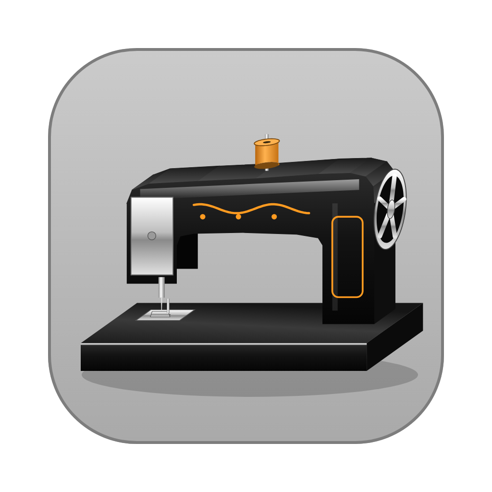
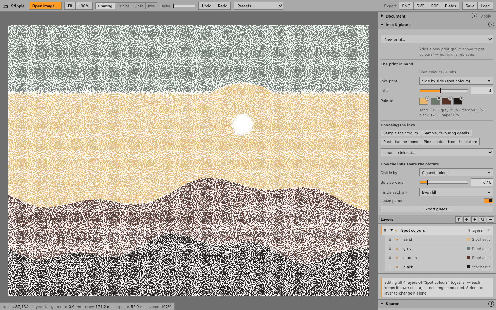

# Stipple

Turn photographs into stippled, screened and line-drawn point art, then split it into
films you can burn onto screens.



I've been using this to have some screen printing fun at home, and it's freely available
to anyone who'd like the same. It isn't a product. It's a tool that has made a lot of
prints I'm happy with, and I hope it does the same for you.

**[Try it in your browser →](https://aallevi.github.io/stipple/)** No install needed.
Everything runs on your machine, and your images never leave it.

- **Layers and groups.** Each layer has its own algorithm, shape, size, tone mask and
  blend mode, and can read *the drawing beneath it* instead of the photo. Groups let you
  edit a set of layers together or one at a time.
- **Three distributions.** Stochastic (jittered), weighted Voronoi (on the GPU, up to a
  million dots) and classic halftone screens.
- **Any shape as a dot.** Choose from the built-in shapes or drop in your own SVG or
  transparent PNG. Shapes stay vector all the way out.
- **Made for printing.** Spot colours that sit side by side or plates that overprint, a
  palette you sample, pick or set by tone range, and one black-on-white film per ink.
- **Sizes that mean something.** Everything is relative to the picture, shown in mm or
  inches: resize or upscale the document and the drawing keeps its proportions.
- **Compare as you go.** Flip between the drawing, the photo, a split view, and the
  picture in just your inks — on screen only, never in a file.
- **Anywhere.** In the browser, as a desktop app, or on a phone. Nothing is uploaded.

---

## Install

To run it locally, or to work on it:

You need [Node.js](https://nodejs.org) 20 or newer and a browser with WebGL2 (any recent
Chrome, Firefox, Safari or Edge).

```bash
git clone https://github.com/aallevi/stipple.git
cd stipple
npm install
npm start
```

`npm start` builds the app and opens it at <http://localhost:4173>. Press `Ctrl-C` in the
terminal to stop it. That's the whole install; you don't need Rust or a desktop shell.

| Command | What it does |
|---|---|
| `npm start` | Build, then serve and open in your browser |
| `npm run dev` | Live-reloading dev server at <http://localhost:1420> |
| `npm run build` | Type-check and write a static site to `dist/` |

`dist/` is plain static files with relative paths, so you can host it anywhere, from a
folder on a web server to GitHub Pages. The live copy above is redeployed from `master`
on every push by `.github/workflows/pages.yml`.

### Optional: the desktop app

A native window (Tauri v2) adds two things: native file dialogs and TIFF import. To build
it you also need a [Rust toolchain](https://rustup.rs).

```bash
npm run app            # run it in dev mode
npm run app:build      # bundle → src-tauri/target/release/bundle/
npm run install-app    # macOS: build and copy into /Applications (add -- --launch to open it)
```

---

## Usage

1. **Open an image.** Drop it on the empty canvas, tap *Open image…*, or press `⌘O` /
   `Ctrl+O`. Drop another later to swap the picture under your drawing.
2. **Pick a preset** to see what's possible: *Classic stipple*, *Voronoi drawing*,
   *Three-angle screens*, *Contour lines* and others.
3. **Set the document** (top of the sidebar) to the size and dpi you'll print at, in
   pixels and millimetres with a ratio lock. *2×* upscales: the same print, every dot
   drawn with twice the pixels.
4. **Make a print** in *Inks & plates*, if you're printing in several inks (below).
5. **Work down the sidebar.** The selected layer's sections follow the signal: *Source →
   Image adjust → Measure → Tone mask → Distribution → Shape → Size → Rotation →
   Colour → Transform → Blend*. A setting only affects the sections below it, and the
   ⓘ buttons explain the ones whose names don't say enough.
6. **Compare** with the photo beside *Fit*: *Original*, *Split* (drag the orange
   divider), *Inks* — the picture in just your print's inks, flat, or in its own eight
   colours before there is a print — or *Under* to see it faintly through the paper.
   It is only a view and never appears in an export.
7. **Export** to PNG, SVG or PDF, or **Plates** for screen printing. Heavy changes show
   a progress bar over the last drawing instead of freezing the window.

### From photo to screens

Everything about the print lives in **Inks & plates**, at the top of the sidebar. A print
is a group of layers, one per ink.

- **Make one.** *New print…* is always at the top of the panel, with the same options:
  **spot colours** (2–8 inks found in the picture) or **overprinting plates** (CMYK, CMY,
  RGB, risograph, earth, tritone, duotone). The line under it says what it will do: turn
  the selected layer into the print, or — with a print already in hand — add a second
  group beside it, replacing nothing.
- **An ink's colour is its swatch.** Ink layers have no Colour section of their own; select
  one and its swatch is marked in the palette. Its ink opacity is in Blend.
- **Spot colours** sit side by side: each ink owns the part of the picture closest to its
  colour, so screens never overprint. **Overprinting plates** print over each other and
  mix, as process printing does. *Inks print* switches a group between the two and keeps
  its inks.
- **Edit the inks.** Each swatch is one ink layer: recolour it, or press its *×* to remove
  that ink. *Sample the colours* (by area), *Sample, favouring details* (every colour
  counts the same, so a small distinct detail wins an ink), *Posterise the tones*, an
  ink set, or *Pick a colour from the picture* — picked inks stay when you sample
  again. *Divide by → Tone ranges* shows the histogram: drag where each ink starts and
  stops. Select the group to change every ink at once, or one layer to give that
  ink its own shape, size or pattern.
- **Export plates** writes one SVG film per ink, solid black on white, plus a colour
  proof, with identical registration marks on every film.

### Layers and groups

Groups are folders in the layer list. Select the folder to edit all its layers together
(each keeps its own colour, screen angle and seed); select a layer inside to change only
that one. Fold, hide, drag and duplicate a group as one; drop a layer between two of its
layers to put it in, drag it out to take it out, and *⇱* dissolves the folder.

### Shortcuts

| Key | Action |
|---|---|
| `⌘O` | Open image |
| `⌘Z` / `⇧⌘Z` | Undo / redo |
| `⌘]` / `⌘[` | Raise / lower the selected layer |
| `0` | Fit to window |
| `Esc` | Cancel picking a colour |

Use `Ctrl` instead of `⌘` on Windows and Linux. On the canvas, drag to pan, scroll or
pinch to zoom, and double-click or double-tap to fit. Reorder layers by dragging the
grip, and add a shape by dropping an SVG or PNG on the shape panel.

On a phone, the picture sits on top and the controls scroll underneath; turned
sideways, they sit side by side. Swipe up and down to scroll, drag sideways to move a
slider, and use the plain strip down the right edge to scroll past anything.

### Files

| | Formats |
|---|---|
| Images in | PNG, JPEG, WebP, GIF, BMP, plus TIFF in the desktop app |
| Shapes in | SVG, or PNG/WebP/GIF with transparency |
| Out | PNG at the document resolution, SVG, PDF, SVG plates |
| Projects | *Save* and *Load*: `.stipple` in the desktop app, `.stipple.json` in a browser |

---

## Learn more

- **[The guide](docs/GUIDE.md)** explains every control, how they relate, and the full
  screen-printing workflow.
- **[Architecture](docs/ARCHITECTURE.md)** covers the dirty-graph engine, GPU Voronoi,
  signed-distance shapes, tiled export and the test suites.

```bash
npm test               # unit tests
npm run verify         # end-to-end browser checks (with `npm run dev` running)
python3 scripts/make-icon.py   # regenerate the icon and toolbar mark
```

Issues and pull requests are welcome. Prints made with it are even more welcome.

## License

[MIT](LICENSE). Use it, change it, print with it.
