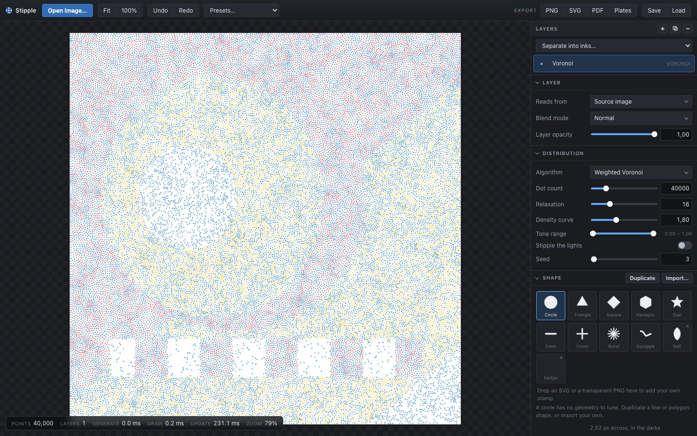

# Stipple

A stippling tool for turning photographs into generative point drawings, in the vein of
[Pointillist](https://www.stochaster-apps.com/pointillist.html) — with two things that
tool does not have: a real layer stack, and shapes you can import.



Runs as a macOS/Windows desktop app (Tauri v2) with a WebGL2 engine. Everything is
local; nothing is uploaded anywhere.

---

## What it does differently

**A stack, not a single pass.** Pointillist applies one configuration to the whole
image. Here every layer has its own algorithm, shape, colour, tone mask, blend mode and
transform — and a layer can be set to read *the render beneath it* rather than the source
photo (`Reads from → Layers below`). Blur that input and the dots underneath become
continuous tone, so the upper layer lands exactly where the lower one laid ink. The ink
is the mask. No other setting reproduces that.

**Imported shapes are not a special case.** Drop in an `.svg` or a `.png` with
transparency and it joins the shape library beside the built-ins. Every shape — circle,
polygon, line, your file — is rasterised to a signed distance field in one atlas, so an
imported logo supports every size, rotation and colour mode, stays crisp at any scale,
and comes out of SVG and PDF export as real vector geometry rather than a traced bitmap.

**Efficiency is structural, not incidental.** Point buffers hold only *invariants* —
position, tone, gradient, a stable random. Size, rotation and colour are derived in the
vertex shader from those plus layer uniforms. Dragging a size or colour slider therefore
costs a uniform update and one instanced draw call; it does not regenerate a single
point. In the verification run, thirty consecutive appearance edits on a 240,000-point
stack do exactly zero generation work.

---

## Getting started

```bash
npm install
npm run app          # desktop app in dev mode
```

`npm run dev` alone serves the same UI in a browser at <http://localhost:1420>, which is
faster to iterate on. Only native file dialogs and TIFF decoding need the desktop shell.

To produce a distributable bundle:

```bash
npm run app:build    # -> src-tauri/target/release/bundle/
```

Requires Node 20+ and a Rust toolchain.

---

## Upgrading an installed copy

The bundle in `/Applications` is disposable build output. **This project directory is the
only master copy** — the app has no auto-update and no persisted state inside the bundle
(projects are `.stipple` files you save wherever you like), so upgrading is just building
again and replacing it.

```bash
cd ~/Documents/Claude/Projects/stipplingtool
npm run install-app
```

That quits Stipple if it is open, rebuilds, and swaps the bundle in `/Applications`.
`/Applications` is group-writable by admin users, so no `sudo`. Options:

| | |
|---|---|
| `npm run install-app -- --launch` | reopen the app when it is done |
| `npm run install-app -- --skip-build` | install whatever is already built |

The copy is staged beside the destination and moved into place, so an interrupted install
cannot leave a half-written bundle behind.

**Working with Claude on it.** Point a session at this directory and describe the change;
the source gets edited here, and `npm run install-app` is what puts it in your Applications
folder. Nothing about the installed copy needs to be touched by hand — and nothing in it is
worth preserving, so it is always safe to replace.

While iterating, `npm run app` is faster than a full rebuild, and `npm run dev` (browser at
<http://localhost:1420>) is faster still. Only native file dialogs and TIFF decoding need
the desktop shell.

---

## Using it

Open an image (the app starts on a synthetic test card so there is always something on
screen), pick a preset to see the shape of things, then work down the sidebar.

### How the controls relate

Everything on the right-hand side is one chain. Knowing where a control sits in it
is usually enough to predict what it will do.

```
 SOURCE ──► Image adjust ──► Ink ──────► tone 0..1 ──┬──► Tone mask ──► keep / drop
            gamma, blur,     luma, or                │
            brightness,      coverage of             └──► Distribution ──► where the
            contrast,        one ink                      spacing / lineature / count
            sharpen, invert                                        │
                                                                   ▼
                                            POINT (x, y, tone, gradient, random)
                                                                   │
   ink = tone, flipped by "Swap light / dark"                      │
        │                                                          ▼
        ├─► Size      = Size × lerp(1 − Tone spread, 1, ink ^ Tone response)
        │                     × (1 ± Size jitter)          ── in canvas px
        ├─► Rotation  = Angle + random·Randomness + contour·Follow contours
        └─► Colour    = mode(tone, random) × (1 ± Colour jitter)
                        or, in Spot inks: nearest ink to the pixel,
                        dithered towards a second one by Mixing
                                                                   │
                                                                   ▼
                                                    ┌──── the stamp ────┐
   circle / polygon     across = Size × 0.84                   ← 0.84 leaves the
   line family          across = Size × 0.84 × Length            distance field
                        stroke = across × Thickness              room to fall off
                                                                   │
                                            Transform (scale, rotate, offset, flip)
                                                                   ▼
                                            Blend mode + Layer opacity ──► the layer below
```

Two rules fall out of that, and they are the ones worth remembering:

**Shape parameters are fractions; `Size` is the only absolute.** `Length` is a
fraction of the mark's cell and `Thickness` is a fraction of the mark's own length,
so both are scale-free — a line keeps its proportions when you resize the layer, and
thickening one grows it inward instead of pushing it out of its cell. The panel shows
the pixels each fraction resolves to, so you never have to do that arithmetic.

**Size is a ramp, not a number.** `Size` sets the dark end; `Tone spread` says how
much smaller the light end gets; `Tone response` is the curve between them. Leave the
response at 1 for drawing — mark width tracks tone. Set it to 0.5 for anything meant
to print: ink coverage goes as the square of the dot, so a linear ramp lays a 50%
grey down at about 68%.

**Distribution** — how points are placed.

| Algorithm | Character | Good for |
|---|---|---|
| Stochastic (jittered grid) | Blue-noise-ish, density from tone | The workhorse; instant at any density |
| Weighted Voronoi | Evenly spaced, hand-stippled feel | Fine-art stipple, plotter output |
| Halftone screen | Regular lattice, tone carried by dot size | Print separations, rosettes, line screens |

**Shape** — the library sits at the top of the section, so picking a stamp and tuning it
is one movement. Whichever shape is selected exposes its own geometry below the grid: a
line shape gives you `Arms`/`Segments`, `Length`, `Thickness` and `Waviness`, a polygon
gives you `Sides`, `Inner radius` and `Irregularity`. Those edits belong to the document,
and they are shared by every layer pointing at that shape — `Duplicate` forks it first if
you want a six-armed burst and a sixteen-armed one in the same stack.

**Size** — `Size` is the overall scale, `Tone spread` how much smaller the quiet end
of the range gets, `Tone response` the curve between them (0.5 for print, 1 for
drawing). The readout resolves the pair into pixels.

**Rotation** — a fixed `Angle`, per-mark `Randomness`, and `Follow contours`, which
aligns each mark to the image's contours and is what makes line shapes flow around forms.

**Ink** — what the layer measures. `Overall tone` is the default. `One ink` measures
how much of a single ink the image asks for at each pixel, which is what makes a layer
one plate of a separation; `Undercolour` decides how much of the neutral component it
leaves to a black plate.

**Colour** — solid, adaptive (hue ramps with tone), sampled from the image, a random
palette pick per point, or **spot inks**. This is the ink the layer *prints with*, which
is separate from the ink it *measures* — the Ink section has a button to match one to
the other.

### Printing it by hand

There are two ways to get from a photograph to a set of screens, and they make
different-looking prints. The tool supports both, and the difference is worth
understanding before you pick one.

**Spot inks — one layer, one dot, one ink.** Set `Colour mode → Spot inks`, choose two
to eight inks, and every dot is printed with exactly one of them. That is the whole
point: a dot is a hole in a screen, and a screen holds one colour, so a drawing where
each mark commits to an ink is a drawing you can actually pull. `Mixing` decides how
strictly each dot is held to its nearest ink:

| `Mixing` | What you get |
|---|---|
| 0 | **Posterised.** Every dot takes the nearest ink; areas come out flat and unmixed — brown, light brown, ochre, with visible boundaries between them. |
| ~0.5 | **Partly mixed.** Dots stray towards a second ink near the boundaries, softening them, while the bands stay readable. |
| 1 | **Scattered.** Dots dither between the two inks that best rebuild the colour and the eye does the mixing. With cyan, magenta and yellow this is a process print. |

`Leave paper` adds the stock as a candidate that is matched against but never printed,
so highlights come out as bare paper instead of spending a whole screen on the palest
ink. `Propose inks from the image` clusters the photograph and fills the palette with
the colours it is actually made of, skipping anything close to the paper.

One thing to know: by default a layer already gets fewer dots *and* smaller dots in the
lights, and in spot mode the ink choice lightens them a third time — so the print comes
out much paler than the photograph. The panel notices and offers **Set up for even
coverage**, which lays dots down evenly at one size and leaves lightness entirely to
which ink each dot takes. That is what a real scatter separation does.

**Process separations — one layer per ink.** The menu at the top of the layer stack
replaces the stack with one plate per ink: CMYK, CMY, RGB, duotone or tritone, screened
or stippled. Here each layer *measures* the coverage of its own ink and prints solid in
it; the plates multiply, carry the classic 30°-apart screen angles, and only the black
plate carries the neutrals, so total ink coverage stays printable. Each plate is an
ordinary layer afterwards — change its ink, its screen, or its shape like any other.

Use spot inks when you want to choose the colours, and when a posterised or hand-printed
look is the point. Use process separations when you want a faithful reproduction and are
happy to print C, M, Y and K.

**Plates** — the `Plates` button separates whatever is on screen into films: one SVG per
ink, solid black on white, plus a colour proof, all with identical registration marks in
a margin outside the artwork. It works on either route — a spot layer is split dot by
dot, and a stack of solid-coloured layers is split layer by layer — and it tells you
which screens it found before it writes anything. A layer that is not one ink (a hue
ramp, or colour sampled straight from the image) cannot belong to a single screen, so it
is left out and named in the warning.

**Document** — width and height are staged, not applied live: resizing invalidates
every cache and re-runs every distribution, so a drag across the slider would queue
thousands of full rebuilds. The readout shows what you are about to get, in pixels and
in inches at the current resolution; Apply commits it.

**Tone mask** — restrict a layer to a slice of the tonal range, with feathered edges.
Two layers with complementary masks and different shapes is the cheapest route to a
hand-drawn look: coarse marks in the shadows, fine ones in the light.

**Image adjust** — per-layer brightness, contrast, gamma, blur, sharpen, invert. Note
the order: gamma, then blur, then brightness, then contrast. Blur precedes the grade so
that a layer reading the render below it has continuous tone to work with, and brightness
precedes contrast so the contrast pivot can be moved onto whatever part of the range the
input actually occupies.

Export is PNG (tiled at the document DPI), SVG, PDF, or `Plates` for screenprinting.
Both vector formats emit one definition per shape and one instance per point, so files
stay proportionate — though past a few hundred thousand points any vector file becomes
slow to open, and the export dialog will say so. Plate export writes SVG only; open the
films in any vector editor if your bureau wants PDF.

---

## How it works

```
source image ─┐
              ├─► density map ──► distribution ──► point buffer ──┐
layers below ─┘   (prefilter,      (jittered /      (x, y, tone,  │
                   gradient,        voronoi /        gradient,    │
                   mip chain)       halftone)        random)      │
                                                                  ▼
                                        shape atlas (SDF) ──► instanced draw ──► layer FBO
                                                                                     │
                                                            blend mode + opacity ────┤
                                                                                     ▼
                                                                              composited stack
```

**The dirty graph** (`src/core/store.ts`, `src/pipeline/engine.ts`). Every mutation
declares how much it invalidates, derived from which fields it touches:

| Edit | Invalidates |
|---|---|
| colour, size, rotation, opacity, blend, shape | the draw only |
| spacing, algorithm, tone mask | that layer's points |
| prefilter, input source | that layer's density map, then its points |
| source image, canvas size | everything |

A change also cascades *upward* to any layer above it that reads from below, and never
downward. Layers cache their density map, point buffer and GPU batch independently.

**Weighted Voronoi on the GPU** (`src/dist/voronoi.ts`). The textbook implementation
rebuilds a Delaunay triangulation on the CPU every Lloyd iteration and stalls somewhere
around twenty thousand points. Here each iteration is a fixed handful of draw calls:
splat the sites into a grid, jump-flood until every pixel knows its nearest site (that
*is* the Voronoi diagram), additively scatter every grid pixel into its site's
accumulator to sum weighted centroids, then divide. Nothing returns to the CPU until the
last iteration. Sites are seeded by importance sampling the ink, so the relaxation budget
goes into refining rather than migrating points out of the highlights.

**Signed distance fields** (`src/shape/sdf.ts`, `src/shape/atlas.ts`). Shapes are
rasterised once, converted to an SDF by an 8SSEDT sweep, and packed into a single R8
atlas. The fragment shader antialiases from the distance with a threshold that scales
with the drawn size, so a 2px dot on screen and the same dot at 400px in a 300dpi export
are both correct with no regeneration. Sub-pixel points are drawn at one pixel with
alpha carrying the lost area, which keeps dense stipples from thinning out.

**Tiled export** (`src/export/png.ts`). Because point buffers are in canvas space, a 4x
export changes only the view matrix and a size uniform. Tiles are 2048² regardless of
output size, so print resolution does not need a proportionally large render target.

---

## Verification

```bash
npm run typecheck
npm test             # 45 unit tests, no browser needed
npm run verify       # 22 end-to-end checks in headless Chromium
```

`npm test` covers the DOM-free half: the distance transform against exact Euclidean
distances, distribution determinism and tonal response, the prefilter ordering, the
store's invalidation levels and history coalescing, and the CPU mirror of the point
shader that vector export relies on.

`npm run verify` needs `npm run dev` running in another terminal. It drives a real
browser through every preset, checks each one actually puts ink on the canvas, imports
an SVG and a PNG as shapes and confirms both render and reach the vector export, proves
a `Reads from → Layers below` layer differs from the same layer reading the source,
round-trips all three export formats, and asserts the dirty graph does no work it should
not. Screenshots and sample exports land in `artifacts/`.

Two notes on what those numbers mean. Headless Chromium rasterises through SwiftShader,
so wall-clock draw timings from `verify` are software-rasteriser figures and are not
reported as GPU performance. Point generation is CPU work and is reported: a
240,000-point stack builds in around 45ms.

---

## Layout

```
src/
  core/       project model, store with dirty levels, undo, seeded RNG
  image/      decode, density map (prefilter, gradient, mips, CDF), test card
  dist/       point generators: jittered, voronoi (GPU), halftone
  shape/      SDF generation, atlas, rasteriser, SVG/raster import
  gl/         context helpers, instanced point renderer, compositor
  pipeline/   engine — owns GPU resources and every cache
  export/     png (tiled), svg, pdf, and the shared shader mirror
  ui/         panels, controls, shape parameters, presets
src-tauri/    desktop shell; Rust decodes TIFF, which web views cannot
```
